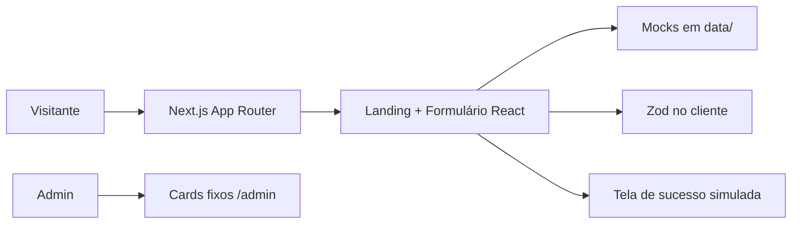
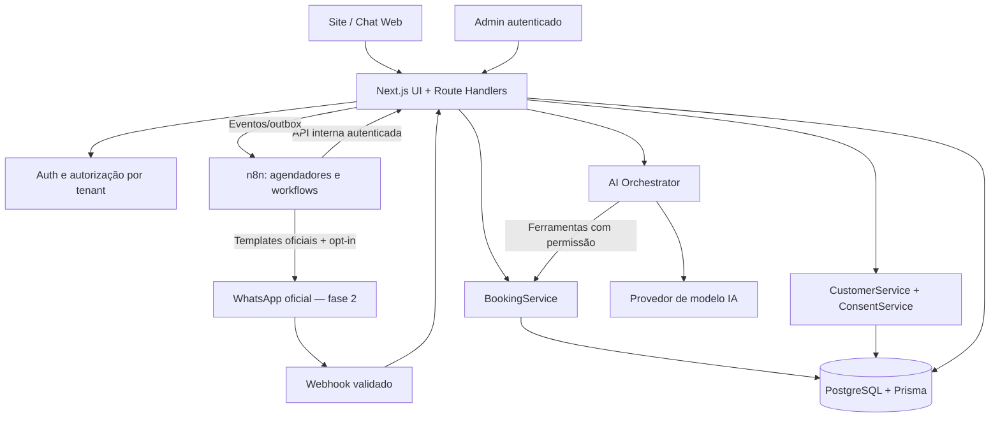
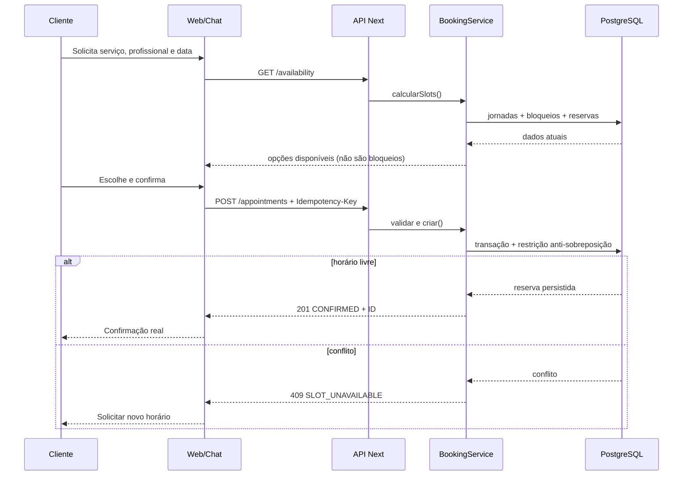
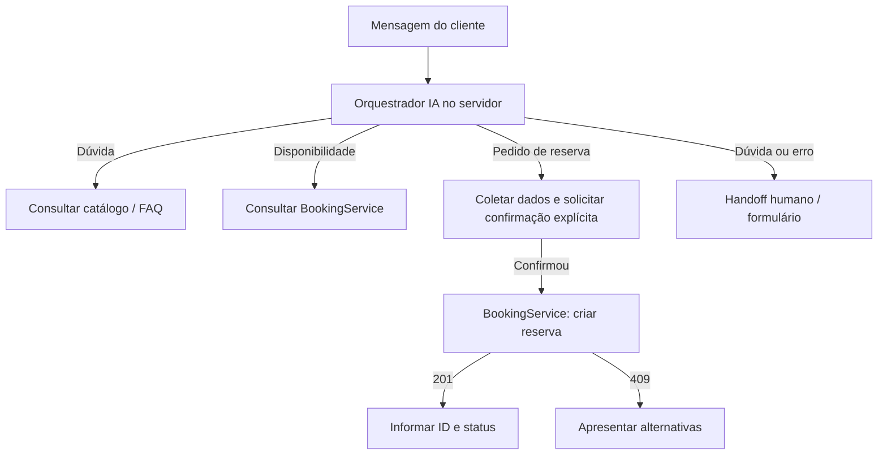

# Arquitetura — BarberFlow IA

**Versão:** 0.1, arquitetura proposta • **Data:** 2026-10-28  
**Fonte AS IS:** revisão dos arquivos no commit `0329bfc`.

## 1. Situação atual



**Confirmado:** não há banco de dados ou motor de disponibilidade no repositório analisado; `BookingForm.confirmBooking()` espera 800 ms e mostra sucesso sem persistir. `/admin` é UI demonstrativa.

## 2. Arquitetura-alvo: monólito modular no Next.js

**Decisão:** começar com **Next.js App Router + Route Handlers (Node.js no servidor)**, separando módulos por domínio. Evitar um serviço NestJS/Express adicional no primeiro MVP: uma segunda API acrescentaria deploy, autenticação, observabilidade e contratos sem necessidade validada. Extrair serviços depois, se houver carga ou equipe suficiente.



**Regra estrutural:** somente `BookingService` consulta regras e grava a agenda. IA interpreta intenção, **não decide disponibilidade**, não escreve direto no banco e não envia mensagens arbitrárias sem guardrails. O n8n coordena fluxos, mas não representa a fonte de verdade de reservas/consentimento.

### Módulos sugeridos

```text
app/
  (marketing)/                 # landing e páginas públicas
  agendamento/                 # formulário conectado à API
  admin/                       # rotas protegidas
  api/v1/
    services/ route.ts
    barbers/ route.ts
    availability/ route.ts
    appointments/ route.ts
    chat/messages/ route.ts
    webhooks/whatsapp/ route.ts  # fase 2
src/
  server/
    auth/
    db/
    modules/
      booking/                 # domínio e regras de slots
      catalog/
      customers/
      consent/
      ai/
      campaigns/
    integrations/
      llm/
      messaging/
      n8n/
prisma/
  schema.prisma
  migrations/
tests/
  integration/
  concurrency/
  e2e/
```

Esta estrutura é **sugerida**, não afirma existência dos arquivos. Adotar gradualmente, mantendo o código legado funcional.

## 3. Fluxo de reserva — sem dupla marcação



**Invariantes:**
- Slots retornados por GET são somente informativos, não garantias de bloqueio.
- Persistência em transação e **restrição no PostgreSQL para impedir intervalos sobrepostos** por profissional, além de checagem da aplicação. Exemplo: `EXCLUDE USING gist (barber_id WITH =, tstzrange(starts_at, ends_at, '[)') WITH &&) WHERE (status = 'CONFIRMED')` após habilitar `btree_gist`; ajustar migration Prisma SQL, tipo de ID, status e política de estados.
- Usar chave de idempotência por requisição de criação; retries não criam reservas extras.
- Horário em UTC no armazenamento e timezone IANA da barbearia (piloto: `America/Sao_Paulo`).
- Cancelamento libera vaga somente após transição autorizada, auditável.

## 4. Fluxo da IA e ferramentas



Ferramentas permitidas: `listServices`, `listBarbers`, `getAvailability`, `createAppointment` (com consentimento do cliente para ação), `cancelAppointment` (com identificação autorizada). Cada tool valida tenant, schema e rate limit. Não enviar credenciais nem dados desnecessários ao modelo. Tratar entradas, documentos e respostas externas como dados, nunca instruções privilegiadas.

## 5. Automação de reativação com n8n

1. Cron diário aciona workflow autenticado.
2. API interna calcula elegíveis: consentimento de marketing, última visita/agendamento, sem reserva futura, sem opt-out, limite de frequência, horário de envio permitido.
3. Workflow solicita envio pelo canal autorizado. Para WhatsApp proativo, usar templates aprovados e verificar requisitos atuais do provedor.
4. Provedor informa status pelo webhook verificado; gravar `MessageDelivery` e `CampaignEvent`.
5. Nova reserva pode receber código de campanha para atribuição, sem inventar relação causal.
6. Resposta `PARAR`/opt-out interrompe envios seguintes rapidamente.

**Segurança:** n8n não acessa SQL livre nem chaves de banco; recebe tokens de escopo mínimo para endpoints internos. Se n8n falhar, agenda e chat continuam operacionais. Implementar outbox/retry e deduplicação antes de disparos em escala.

## 6. Modelo de domínio — entidades propostas

| Entidade | Campos mínimos | Nota |
|---|---|---|
| Tenant/Barbershop | id, name, timezone, status | Piloto: 1 tenant, mas scoping sempre obrigatório |
| User/Membership | id, tenantId, role, authIdentity | Proprietário/atendente |
| Barber | id, tenantId, name, active | Profissional |
| Service | id, tenantId, name, durationMin, priceCents, active | Dinheiro inteiro em centavos |
| WorkingHours | tenantId, barberId, weekday, startLocal, endLocal | Jornada base |
| TimeOff/Block | tenantId, barberId, startsAt, endsAt, reason | Folga e bloqueio |
| Customer | id, tenantId, name, phoneNormalized | PII; acesso controlado |
| Consent | id, tenantId, customerId, purpose, channel, source, grantedAt, withdrawnAt | Evidência da escolha |
| Appointment | id, tenantId, customerId, barberId, serviceId, startsAt, endsAt, status, source, campaignId? | Reserva real |
| Conversation/Message | tenantId, customerId?, channel, externalId?, metadata | Minimizar retenção |
| Campaign/Delivery/Event | tenantId, customerId, channel, template, status, dedupeKey, sentAt | Medir e auditar |
| AuditEvent/OutboxEvent | tenantId, actor, action, createdAt, payloadMin | Auditoria e entrega confiável |

## 7. Isolamento, autenticação e observabilidade

- Autorizar cada operação por `tenantId` derivado de sessão/token confiável, **nunca só do corpo enviado pelo navegador ou pela IA**.
- Login obrigatório no admin; papéis `OWNER` e `STAFF`. Não permitir que um cliente público liste telefones de outros clientes.
- Webhooks: verificar assinatura do provedor, timestamp/replay, deduplicar IDs.
- Rate limit de chat e reservas; validação server-side com Zod, logs sem tokens/PII, backups e restore testado.
- Monitorar taxa de falhas, tentativas de double-booking, custo por conversa, disponibilidade, latência e opt-outs.
- Dev/prod: migrar banco com revisão, variáveis secretas fora do repositório, CI de lint/test/build e seeds sem PII real.
- Definir aviso de privacidade, exclusão/exportação, prazos de retenção, responsáveis e base legal com orientação jurídica antes da operação comercial.

## 8. Evolução e limites

- **Pilot:** uma única barbearia, chat web, automação consentida através de canal efetivamente integrado.
- **Fase 2:** integração oficial WhatsApp para conversa e envio proativo, fila de espera e tratamento de cancelamentos.
- **Fase 3:** múltiplos tenants comerciais, billing, quotas por plano, suporte e dashboards.
- Revisar integração WhatsApp e categoria de templates conforme documentação Meta vigente, políticas locais e custos atualizados na data de implementação.

## 9. Decisões pendentes

Provedor de LLM e limites de custo; auth gerenciada vs biblioteca; PostgreSQL hospedado; canal de reativação do piloto; regras de adiantamento/cancelamento, fuso de cada loja; provedor WhatsApp; exigência de confirmação de telefone; retenção de mensagens. Ver também [ADR-001](./ADR-001.md).
