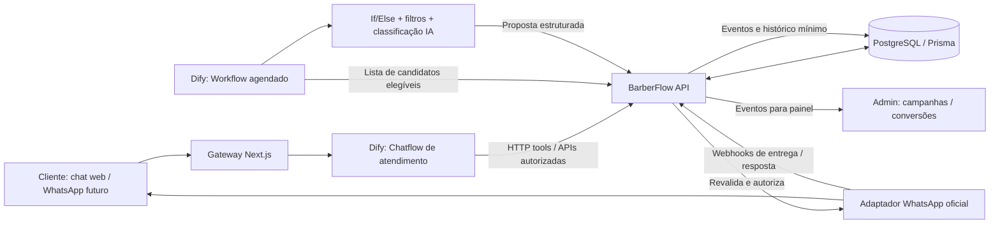
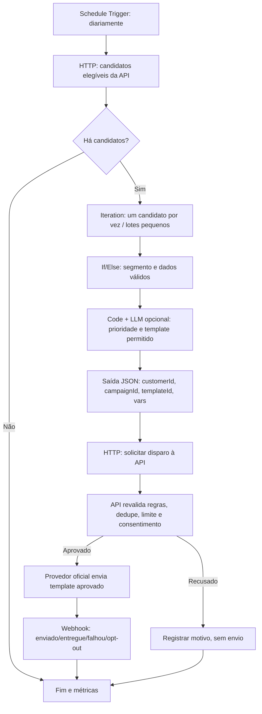

# BarberFlow IA — Orquestração de dados e agentes no Dify

**Versão:** 0.1 (proposta técnica)  
**Data:** 2026-10-28  
**Estado:** desenho para implementação futura; **não significa que os fluxos, APIs ou integrações já estejam implementados**.  
**Relacionados:** [PRD](./PRD.md) · [Arquitetura](./ARCHITECTURE.md) · [SPEC do MVP](./SPEC-MVP.md) · [Backlog](./BACKLOG.md)

## 1. Decisão de produto

O **Dify** será a camada principal de experiência conversacional e de orquestração de IA. Além de conversar com o cliente, ele poderá **priorizar, entre clientes previamente elegíveis, quem abordar e qual campanha sugerir**, com dados fornecidos pela API do BarberFlow. O **BarberFlow/Next.js + PostgreSQL** é a fonte de verdade e a instância que autoriza cada envio e cada reserva.

**Duas responsabilidades diferentes:**

1. **Regras obrigatórias (determinísticas, no BarberFlow):** tenant correto, base legal/consentimento quando aplicável, canal autorizado, opt-out, janela e horário permitido, limites de frequência, existência de agendamento futuro, idempotência, orçamento e disponibilidade real.
2. **Decisão assistida por IA (Dify):** interpretar mensagens, classificar intenção, sugerir segmento e prioridade entre candidatos elegíveis, selecionar o *template* permitido, preencher variáveis, propor resposta apropriada e encaminhar dúvidas a atendente.

A IA **nunca** pode retirar uma pessoa da lista de bloqueados, ignorar consentimento ou confirmar horário sem retorno da API. A seleção de clientes não é uma decisão irrestrita da LLM.

## 2. Topologia recomendada



**n8n é opcional.** Usá-lo depois para conectores externos, múltiplos canais ou integrações difíceis de manter no Dify. Evitar duplicar a mesma automação nos dois sistemas. A versão do Dify utilizada deve suportar os gatilhos de Workflow planejados; verificar o ambiente Cloud ou self-host antes de implementar.

## 3. Três fluxos separados no Dify

### Fluxo A — Atendimento e agendamento (Chatflow)

**Entrada:** cliente inicia conversa no site (WhatsApp oficial é fase posterior).

1. **User Input/Chatflow:** texto, ID de sessão e contexto de tenant recebido do backend autenticado.
2. **Question Classifier ou LLM:** distinguir FAQ, preços, disponibilidade, agendamento, reagendamento, cancelamento, pedido de ajuda, opt-out.
3. **Knowledge Retrieval (opcional):** FAQ, política da barbearia, horários gerais, serviços. **Não usar base de conhecimento como fonte de agenda em tempo real**.
4. **HTTP Request / Tool:** consultar `GET /api/v1/services`, `/barbers` e `/availability` via gateway protegido.
5. **If/Else:** faltam dados? perguntar; há horários? apresentar opções reais; houve erro? informar e oferecer atendimento humano.
6. **Confirmação explícita:** cliente escolhe serviço, profissional, data e horário; API executa `POST /api/v1/appointments` com chave de idempotência.
7. **Resposta:** informar ID **somente após** status persistido, ou tratar conflito `409 SLOT_UNAVAILABLE`.
8. **Handoff humano:** em ambiguidades ou quando o cliente solicitar.

**Importante:** segredo da API OpenAI e tokens de Dify ficam no servidor. A assinatura do ChatGPT **não equivale** a créditos de API da OpenAI; o provedor/modelo é configurado separadamente no Dify.

### Fluxo B — Reativação de clientes (Workflow com gatilho de agenda)

**Objetivo:** o Dify escolhe prioridade e estratégia **entre candidatos aptos**, e o BarberFlow confirma a elegibilidade imediatamente antes do disparo.



**Etapas de orquestração de dados no canvas:**

| Nó Dify | Entrada | Saída / decisão |
|---|---|---|
| Schedule Trigger | execução diária configurável | horário da execução |
| HTTP Request | credencial de serviço, campanha, paginação | candidatos *já filtrados* por API |
| Code | JSON de candidatos | normalização e pontuação básica estável |
| Iteration | lista limitada de candidatos | execução por cliente com limites |
| If/Else | segmento, flags e confiança | descarta ou prossegue |
| LLM (opcional) | contexto mínimo e templates autorizados | recomendação **em JSON estruturado** |
| HTTP Request | recomendação + chave de idempotência | `accepted`, `rejected` ou `queued` |
| End / logs | totais, erros, rejeições | auditoria e métricas |

**Observação operacional:** Schedule Trigger é recurso de **Workflow**, não do Chatflow conversacional. Para automação acionada por evento, considerar Webhook Trigger ou workflow iniciado por API, conforme a versão/implantação do Dify. Se não houver gatilho disponível no ambiente escolhido, um agendador controlado do BarberFlow pode iniciar o fluxo.

### Fluxo C — Respostas a campanhas (Chatflow de retorno)

1. Cliente recebe mensagem usando template aprovado e responde.
2. Webhook do provedor WhatsApp chega ao **backend**; validar assinatura, tenant e ID externo.
3. Backend roteia a mensagem para o Chatflow Dify com contexto mínimo de campanha (não instruções livres).
4. Dify identifica interesse, consulta disponibilidade **atual** na API e conduz reserva.
5. API registra o novo agendamento e associa o `campaignId` quando comprovadamente relacionado ao convite.
6. Resposta `PARAR` ou pedido de não receber marketing gera atualização de preferências no **backend**, antes de qualquer outra ação promocional.

## 4. Como definir quem receberá uma mensagem

### Filtro rígido na API — obrigatório, antes do Dify

Um candidato só é enviado ao fluxo se, conforme a finalidade/canal/base legal definidos para o piloto:

- pertence à barbearia (tenant) solicitante;
- tem autorização/base legal válida para o contato e preferência de canal documentada;
- **não** retirou permissão nem fez opt-out;
- tem contato válido e não consta em lista de supressão;
- não possui agendamento futuro incompatível com a campanha;
- passou o período configurado de inatividade (exemplo inicial: **35 dias**, a validar);
- não ultrapassou limite de frequência (exemplo: **um convite a cada 30 dias**, a validar);
- está dentro das regras de horário, orçamento e capacidade de envio.

Esses exemplos são **hipóteses configuráveis**, não regras já operacionais nem orientação jurídica conclusiva.

### Prioridade entre elegíveis — Dify

- **Segmento 1 — Habitual atrasado:** cliente com histórico de retornos regulares cujo intervalo atual supera o padrão.
- **Segmento 2 — Cliente ocasional inativo:** convidar com menor frequência e comunicação discreta.
- **Segmento 3 — Interesse em vaga liberada:** enviar oferta apenas a quem pediu essa preferência, sem prometer exclusividade.
- **Segmento 4 — Cliente com reserva futura:** **excluir da reativação**; pode receber lembrete transacional por fluxo distinto.

**Ranking sugerido para MVP:** função determinística em `Code` (dias desde última visita, intervalo típico de retorno, existência de preferências, frequência de contato), com LLM apenas para escolher entre **estratégias e templates previamente autorizados**. Isso reduz custo, inconsistência e risco de viés. Não inferir atributos sensíveis, condição econômica ou dados íntimos.

### Formato de decisão proposto

```json
{
  "customerId": "cus_demo_123",
  "campaignId": "camp_reactivate_202610",
  "segment": "habitual_atrasado",
  "priority": "medium",
  "templateId": "reactivation_invite_v1",
  "templateVariables": {"firstName": "Joao"},
  "reasonCode": "RETURN_INTERVAL_EXCEEDED",
  "idempotencyKey": "tenant1-camp_reactivate_202610-cus_demo_123"
}
```

A API **não confia** em `templateId`, `campaignId`, `customerId` ou `tenantId` sem autorização do token e nova checagem no banco. O exemplo é ilustrativo e não contém dados reais.

## 5. Contratos de API — proposta, não endpoints existentes

| Método / rota ilustrativa | Quem usa | Contrato e segurança |
|---|---|---|
| `GET /api/internal/campaigns/reactivation/candidates?limit=50` | Workflow Dify | Retorna apenas candidatos elegíveis, campos mínimos, paginação/cursor |
| `POST /api/internal/campaigns/reactivation/dispatch` | Workflow Dify | Recebe JSON estruturado; **revalida** elegibilidade, template, cota e idempotência; enfileira envio |
| `GET /api/v1/availability` | Chatflow via backend | Horários reais por barbeiro/serviço/data |
| `POST /api/v1/appointments` | Chatflow via backend | Confirmação explícita, transação, anti-sobreposição e idempotência |
| `POST /api/v1/marketing/preferences` | Fluxo de opt-out autorizado | Revoga preferência e audita alteração |
| `POST /api/v1/webhooks/whatsapp` | Provedor oficial | Validação de assinatura, replay, deduplicação e status |

**Exemplo de resposta mínima de candidatos:**

```json
{
  "campaignId": "camp_reactivate_202610",
  "candidates": [
    {
      "customerId": "cus_demo_123",
      "firstName": "Joao",
      "daysSinceVisit": 37,
      "typicalReturnDays": 21,
      "preferredServiceId": "svc_haircut",
      "allowedTemplateIds": ["reactivation_invite_v1"]
    }
  ],
  "nextCursor": null
}
```

**Não enviar telefone ao nó de LLM.** Para o disparo, a API recupera o contato no banco após autorizar a ação. As credenciais do Dify devem ter escopo mínimo, rotação, HTTPS, quotas, timeout, retries controlados e logs com dados pessoais mascarados.

## 6. WhatsApp, privacidade e controle humano

- Para **primeira abordagem proativa** ou mensagens **fora da janela de atendimento de 24 horas**, usar **modelo de mensagem aprovado pela Meta**, com categoria/finalidade corretas; dentro da janela aberta por mensagem do cliente, respostas livres são permitidas pelas regras do canal.
- O LLM **não escreve livremente** a mensagem inicial fora da janela: pode escolher um template autorizado e preencher apenas parâmetros permitidos; a API valida antes de enviar.
- Registrar finalidade, evidência da autorização/base legal adotada, opt-out, decisão, versão de template, status do provedor e custo. A adequação à LGPD deve ser revisada para o cenário real.
- Definir limites de contatos, *quiet hours*, orçamento máximo, botão de pausa da campanha, revisão de campanhas novas e encaminhamento a humano.
- Um cliente pode pedir para falar com um atendente; a operação deve oferecer caminho de atendimento humano.
- Se Dify ou WhatsApp falhar, a agenda convencional segue funcionando.

## 7. Métricas e observabilidade

Medir separadamente: candidatos avaliados; clientes aprovados/rejeitados e motivo; mensagens enfileiradas/entregues/falhas; respostas; opt-outs; reservas ligadas à campanha; presença efetiva; receita **realizada** somente quando confirmada pelo sistema financeiro; custo de tokens/modelo, Dify, provedor e mensagens. Atribuição por campanha não prova causalidade.

Criar `CampaignRun`, `CampaignDecision`, `MessageDelivery` e `CampaignEvent` (ou equivalentes). Guardar versão do workflow/prompt, `idempotencyKey` e IDs externos para rastreabilidade, com retenção e acesso mínimos.

## 8. Backlog incremental deste desenho

| ID proposto | Entrega | Dependência | Critério de aceite |
|---|---|---|---|
| DIFY-01 | Configurar workspace, modelo OpenAI via API e ambientes | BF-011 | Segredos fora do repo; consumo de tokens medido |
| DIFY-02 | Chatflow de FAQ + consulta de agenda real | BF-004/005 | Nenhum slot inventado |
| DIFY-03 | Ferramenta de reserva com confirmação e erro 409 | DIFY-02 | Reserva confirmada só pela API |
| DIFY-04 | API de elegibilidade e preferências de campanha | BF-013/014 | Sem consentimento/opt-out/reserva futura não entra |
| DIFY-05 | Workflow agendado + ranking + JSON estruturado | DIFY-04 | Lista pequena auditável, sem envio ainda (*dry run*) |
| DIFY-06 | API de disparo com revalidação e idempotência | DIFY-05 | Reexecução nunca duplica mensagens |
| DIFY-07 | Adaptador WhatsApp oficial + webhooks | BF-017/DIFY-06 | Template aprovado; status/opt-out persistidos |
| DIFY-08 | Chatflow de retorno e métricas por campanha | DIFY-03/07 | Cliente responde, agenda, aparece no painel |
| DIFY-09 | Observabilidade, limites e testes de privacidade | todos | Alertas, custos, pausa de campanha e trilha de auditoria |

**Primeiro experimento seguro:** DIFY-04 + DIFY-05 em *dry run* com dados fictícios: o Dify retorna uma **lista priorizada**, e o painel exibe a proposta, **sem enviar mensagens reais**. Depois habilitar envio somente para uma barbearia piloto e destinatários com autorização válida.

## 9. Pontos a validar antes do desenvolvimento

- Versão específica do Dify (Cloud ou self-host), suporte a gatilhos, autenticação de ferramentas, limites e custo.
- Provedor de WhatsApp oficial, aprovação e custo de templates no Brasil.
- Regras de negócio: intervalo de retorno por serviço, frequência, janela de envio, limites, restrições de contato e transferência a humano.
- Base legal, registros e redação das mensagens conforme LGPD e políticas da plataforma.
- Testes com dados sintéticos e concordância de uma barbearia piloto antes de campanhas reais.

## 10. Referências técnicas

- [Dify — Workflows / Chatflows, triggers e orquestração](https://www.dify.ai/workflows)
- [Dify — Introdução a triggers (v1.10.0)](https://dify.ai/blog/introducing-trigger)
- [Dify Docs — Schedule Trigger](https://github.com/langgenius/dify-docs/blob/main/en/cloud/use-dify/nodes/trigger/schedule-trigger.mdx)
- [WhatsApp Business — Política oficial de mensagens e templates](https://whatsappbusiness.com/policy/)

> **Síntese da arquitetura:** **Dify conversa, prioriza e propõe**; **BarberFlow valida, autoriza, registra e confirma**; **WhatsApp oficial transporta mensagens permitidas**; **n8n continua opcional**.

## 11. Extensão: ofertas comerciais de reconquista

Além de escolher o momento da abordagem, o Workflow Dify pode **sugerir uma oferta previamente aprovada**, por exemplo benefício em corte, combo corte + barba ou serviço + produto. Para isso, consultar a API de ofertas elegíveis antes de chamar o nó LLM, e exigir saída estruturada com `offerId` e `templateId`. A API deve revalidar preço, margem, estoque, orçamento, consentimento e condições antes de emitir cupom ou enviar mensagem. Desconto nunca é criado pela IA.

Fluxo, regras e backlog específicos: [RECONQUISTA-OFERTAS.md](./RECONQUISTA-OFERTAS.md).
