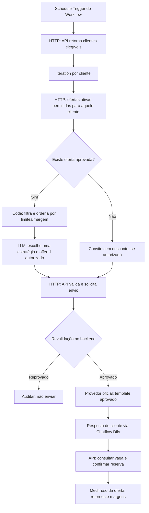

# BarberFlow IA — Reconquista de clientes com ofertas inteligentes

**Status:** proposta (não implementada) • **Versão:** 0.1 • **Data:** 2026-10-28  
**Relacionados:** [PRD](./PRD.md) · [SPEC-MVP](./SPEC-MVP.md) · [Orquestração Dify](./DIFY-ORCHESTRATION.md) · [Backlog](./BACKLOG.md)

## 1. Objetivo e diferencial comercial

O BarberFlow não deve ser apenas um chatbot que chama clientes inativos para agendar. Ele pode atuar como um **assistente de reconquista**, capaz de propor uma oferta coerente com o histórico de serviços e as preferências conhecidas, **apenas dentro de campanhas aprovadas pela barbearia**.

Exemplos: um benefício no próximo corte, um combo corte + barba, uma oferta de produto (pomada, shampoo, óleo para barba) ou desconto em horário de baixa procura. A prioridade é trazer o cliente de volta **com margem saudável**, sem ensinar o cliente a esperar descontos indefinidamente.

A IA **não cria preços, não inventa promoções e não promete estoque ou horários**. Preço, disponibilidade, autorização de contato, aprovação e limites pertencem ao backend BarberFlow.

## 2. Tipos de benefício e quando considerar

| Perfil/contexto | Estratégia | Oferta de exemplo, somente ilustrativa |
|---|---|---|
| Cliente habitual atrasado | Convite simples primeiro; incentivo leve quando campanha permitir | 5% no próximo corte, válido 7 dias |
| Cliente há muito tempo sem visitar | Combo aprovado pelo dono | Corte + barba por preço fechado definido no painel |
| Cliente que já demonstrou interesse em um produto | Serviço + item complementar, condicionado a estoque real | Corte + pomada com desconto no combo |
| Horário menos procurado | Preencher capacidade ociosa, sem conflito com reservas | R$ 5 de benefício em horários especificados |
| Cliente fiel e frequente | Valorizar relacionamento em trilha distinta | Vantagem de fidelidade, sem exigir ausência |

Os percentuais, valores, prazos e faixas de inatividade são hipóteses **a validar com a barbearia piloto**. Um contato não precisa receber desconto: pode receber apenas convite cordial.

## 3. Exemplo de abordagem

**Mensagem de campanha para aprovação, não texto automaticamente autorizado pelo WhatsApp:**

> Oi, {{primeiro_nome}}! Tudo bem? Aqui é da {{nome_barbearia}}. Preparamos uma condição especial para sua próxima visita: {{oferta_previamente_aprovada}}. Ela vale até {{data_validade}} e está sujeita às regras da promoção. Quer que eu veja os horários disponíveis? Se não quiser mais receber ofertas, responda PARAR.

Evitar tom invasivo: não dizer “estamos acompanhando que você está há 35 dias sem aparecer”. Dar acesso às condições completas do benefício. Para envio proativo no WhatsApp, usar template de marketing previamente aprovado e autorização apropriada; personalizar somente os campos permitidos pelo template.

## 4. Regras que a barbearia configura no painel

- **Campanha:** nome, duração, público-alvo, finalidade, canal, dias/horários de envio, orçamento máximo, limite de contatos e aprovação do gestor.
- **Oferta:** ID, modalidade (`PERCENT`, `AMOUNT`, `COMBO`, `GIFT`), itens/serviços elegíveis, valor, validade, máximo por cliente, total de resgates, regras de acumulação e horários elegíveis.
- **Proteção de margem:** preço mínimo por oferta, teto de desconto, custo dos produtos quando disponível, margem de contribuição mínima configurada; descontos calculados no backend em centavos.
- **Estoque e serviços:** verificar disponibilidade antes de oferecer produto; se não há controle de estoque confiável, **não criar campanha com promessa de item físico**.
- **Cliente:** existência de agendamento futuro, frequência de campanhas, preferências de contato, opt-out, elegibilidade, prevenção de cupom duplicado.
- **Aprovação e interrupção:** nenhuma campanha nova dispara sem ativação explícita pelo dono; botão de pausa. O agente pode recomendar, não publicar descontos unilateralmente.

**Critério crucial:** o proprietário decide se quer ativar ofertas com desconto. O Dify pode recomendar um incentivo **apenas dentro do catálogo aprovado**. Nenhum desconto automático para todos os clientes inativos.

## 5. Orquestração de dados no Dify



**Separação técnica:**

- **PostgreSQL + Next.js (fonte de verdade):** clientes, consentimentos, histórico de visitas, serviços, ofertas, preços, disponibilidade de produtos, campanhas, cupons, uso e auditoria.
- **Dify Workflow:** segmenta candidatos já autorizados, avalia o catálogo de ofertas elegíveis, sugere `offerId` e `templateId` e solicita o disparo.
- **Dify Chatflow:** continua a conversa quando o cliente responde, esclarece regras do benefício e consulta horários atuais antes de reservar.
- **WhatsApp oficial (etapa de integração):** transporte de templates promocionais aprovados e respostas; opt-out atualizado imediatamente no backend.
- **n8n:** opcional, para integrações adicionais; não é obrigatório no MVP.

**Regras incontornáveis:** a API revalida cliente/tenant, permissão de contato, campanhas ativas, limite de envios, estoque, margem, cotas, validade, opt-out e idempotência *na hora do envio e do resgate*. A LLM não consulta SQL direto nem recebe telefone quando não precisa.

## 6. Exemplo de contrato de dados

### Entrada mínima enviada ao Dify (dados fictícios)

```json
{
  "customerId": "cus_demo_123",
  "daysSinceVisit": 37,
  "typicalReturnDays": 21,
  "lastServiceId": "svc_corte",
  "eligibleOffers": [
    {
      "offerId": "offer_corte_5pct",
      "category": "SERVICE_DISCOUNT",
      "templateId": "promo_corte_retorno_v1"
    },
    {
      "offerId": "offer_combo_corte_pomada",
      "category": "SERVICE_PRODUCT_BUNDLE",
      "templateId": "promo_combo_retorno_v1"
    }
  ]
}
```

### Saída estruturada sugerida pelo Dify (não é autorização de envio)

```json
{
  "customerId": "cus_demo_123",
  "offerId": "offer_corte_5pct",
  "templateId": "promo_corte_retorno_v1",
  "reasonCode": "RETURN_INTERVAL_EXCEEDED",
  "campaignId": "camp_reconquista_demo",
  "idempotencyKey": "tenant1-camp_reconquista_demo-cus_demo_123"
}
```

A API só aceita `offerId` existente e ativo para aquele tenant e `templateId` associado à campanha. O preço e o código promocional são gerados e validados exclusivamente no backend. Ao cliente, mostrar condições, validade, disponibilidade e preço final antes de confirmar.

## 7. Modelo de dados mínimo adicional — proposta

- `Offer`: tenantId, type, serviceIds/productIds, fixedPriceCents/discountBps, minPriceCents, startsAt, endsAt, restrictions, active.
- `Campaign`: tenantId, audienceRule, approvedBy, enabled, maxBudgetCents, maxContacts, approvedTemplateId.
- `Coupon`: tenantId, campaignId, offerId, customerId, codeHash, expiresAt, status, maxUses.
- `CouponRedemption`: couponId, appointmentId?, saleId?, redeemedAt, discountCents.
- `Product` (catálogo mínimo **somente se** forem ofertados itens): tenantId, name, priceCents, active, availableQuantity, updatedAt; ou integração com estoque confiável.

Separar **cupom emitido**, **cupom associado ao agendamento** e **cupom utilizado em atendimento/compra efetiva**. Reversões e cancelamentos precisam de política definida. Evitar lançar ERP completo no MVP.

**Endpoints sugeridos, ainda não existentes:** `GET /api/internal/marketing/eligible-offers?customerId=...`, `POST /api/internal/marketing/recommendations/dispatch`, `GET /api/v1/offers/:id`, `POST /api/v1/coupons/redeem`. Todos exigem autenticação, escopo de tenant e validação de preço/cotas.

## 8. Medir se a oferta dá resultado

- Clientes abordados, mensagens entregues, respostas e opt-out.
- Reservas e **comparecimentos** após a campanha; produtos vendidos efetivamente.
- Cupons emitidos versus resgatados; receita de serviços, **custo do benefício**, margem de contribuição estimada e custo de IA/mensagens.
- Ocupação de horários de baixa demanda, recorrência de clientes e comparação com **grupo sem desconto** quando viável.
- Atribuição a campanha não prova que a oferta causou a volta. Meta inicial: medir linha de base; só depois fixar metas.

## 9. Backlog desta funcionalidade

| Código | Entrega | Dependências | Aceite |
|---|---|---|---|
| OFR-01 | CRUD de ofertas + regras e autorização do gestor | Agenda real, auth | Proprietário ativa e pausa oferta |
| OFR-02 | Elegibilidade de campanha e catálogo de ofertas válidas | Consentimento + OFR-01 | Sem cliente opt-out nem promoções vencidas |
| OFR-03 | Workflow Dify com ranking e saída estruturada | OFR-02 | `dry run` com dados sintéticos |
| OFR-04 | Cupom único + orçamento + validação de preço/margem | OFR-01/03 | Repetir execução não duplica cupom |
| OFR-05 | Catálogo mínimo de produtos e conferência de estoque (opcional) | OFR-01 | Não oferta item indisponível |
| OFR-06 | Templates promocionais + WhatsApp oficial (fase posterior) | OFR-03/04 + integração canal | Envia apenas com autorização e template aprovado |
| OFR-07 | Resgate de cupom no agendamento/atendimento | Reserva real + OFR-04 | Valor final correto, status rastreável |
| OFR-08 | Painel de resultados e testes de segurança | OFR-06/07 | Métricas de conversão e custo do desconto separadas |

## 10. Primeiro experimento recomendado

Criar três ofertas fictícias em uma barbearia piloto: **convite sem desconto**, **benefício simples no corte** e **combo corte + produto**. Executar o Workflow Dify em **modo simulação (dry run)**, sem enviar WhatsApp e sem prometer estoque. Validar se a seleção é coerente, se os descontos respeitam as margens e se o dono aprova o tom da comunicação. Só depois conectar envio real a clientes devidamente autorizados.

> **Decisão central:** Dify recomenda a oferta; BarberFlow decide se ela é válida, autoriza o desconto e registra o resultado. Reconquista sustentável vale mais do que disparar promoções indiscriminadas.
